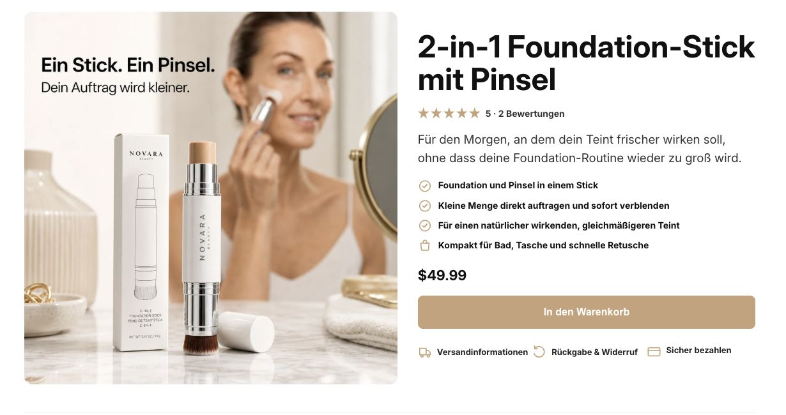
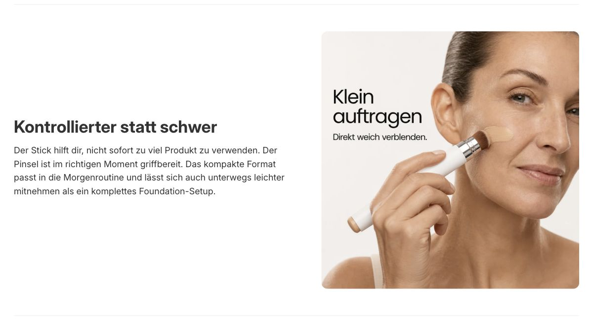
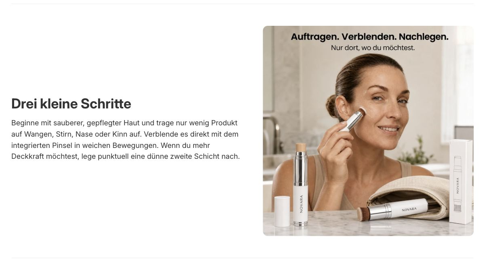

# Ein abgeschlossenes NOVARA-Logic-Beispiel

[← Zur Projektvorstellung](README.md)

## Vom Produktauftrag zur gespeicherten Shopify-Seite

**Produkt: 2-in-1 Foundation-Stick mit Pinsel.**

Diese Beispielstrecke zeigt die tatsächlich vorhandene Shopify-Seite aus einem abgeschlossenen NOVARA-Logic-Auftrag. Die Aufnahmen wurden am 4. November 2026 in der bestehenden Shopify-Vorschau erstellt. Es handelt sich um Inhaltsausschnitte der Seite, nicht um neu entworfene Mockups.

## 1. Was dem Auftrag zugeordnet ist

In der App wurden folgende Punkte geprüft:

- Der Auftrag ist als fertiggestellt gekennzeichnet.
- Eine PDF und zwei Produktbilder sind gespeichert.
- Eine Käuferanalyse ist vorhanden und wurde gelesen.
- Das Ergebnisverzeichnis führt unter anderem Recherche und Rohquellen, Angebotsbriefing, Verkaufstext, Bildprompts, sechs finale Bildrollen sowie Shopify-Exportdateien auf.
- Die App zeigt „Seite vorbereitet“, „Produktbilder eingefügt“ und „In Shopify gespeichert“.
- Der Ergebnislink der App gehört zu derselben Produktvorlage wie die aufgenommene Seite.

Das Ergebnisverzeichnis belegt die Zuordnung dieser Artefakte zum Auftrag. Es ersetzt keine unabhängige Prüfung jeder darin enthaltenen Rechercheaussage.

## 2. Einstieg und Kaufbereich

Der Einstieg verbindet Produktbezeichnung, eine Alltagssituation, Nutzenpunkte, ein Produkt-/Anwendungsbild und den Kaufbereich.

Die Bildaussage „Ein Stick. Ein Pinsel.“ greift das zentrale Produktmerkmal auf. Der Text ordnet es in eine Routine ein: ein frischer wirkender Teint, ohne einen großen Foundation-Aufwand zu beschreiben.

*Die Seite stammt aus einem Development-Store. Der sichtbare Preis und die Sterne sind dort konfigurierte Demo-Inhalte; ihre Echtheit als Kundenbewertungen oder Geschäftsergebnisse wurde nicht bestätigt.*

## 3. Wie die Käuferanalyse weiterverarbeitet wurde

Die gespeicherte Käuferanalyse behandelt folgende Themen. Sie sind hier als Ergebnisse dieses Laufs zusammengefasst, nicht als repräsentativ gemessene Käuferstatistik:

| Thema der Käuferanalyse | Umsetzung in der vorhandenen Seite |
|---|---|
| Foundation soll nicht schwer oder übermäßig wirken | Nutzenkapitel „Kontrollierter statt schwer“ |
| Der Auftrag soll mit einer kleinen Menge beginnen | Bildaussage „Klein auftragen. Direkt weich verblenden.“ und entsprechende Textführung |
| Ein separater Pinsel vergrößert den Aufwand | Das integrierte Pinselende wird als zentrales Merkmal erklärt |
| Schnelle Retusche und Mitnahme sind relevant | Kompaktes Format und Nutzung unterwegs erscheinen im Text |
| Die Anwendung muss verständlich sein | Eigenes Kapitel „Drei kleine Schritte“ mit passender Szene |

Die wichtige Verbindung liegt zwischen Analyse und Ausgabe: Dasselbe Thema wird im Verkaufstext erklärt und in der Bildaufgabe dargestellt.

## 4. Nutzenargumentation als zusammengeführter Abschnitt

Dieser Abschnitt zeigt Text und Anwendungsszene im selben Zusammenhang. Das Argument ist eine kontrollierbare Routine; die Szene zeigt den dazu passenden Auftrag.

Die Aufnahme zeigt die tatsächliche Seitenausgabe. Produktwirksamkeit und wirtschaftliche Wirkung werden dadurch nicht unabhängig nachgewiesen.

## 5. Anwendung mit Text und Bild

Hier wird die Anwendung als kurzer Ablauf beschrieben und mit einer passenden Darstellung verbunden. Die Texte und Bilder wurden für die Seitenausgabe zusammengeführt.

Weitere vorhandene Abschnitte behandeln unter anderem die bisherige Routine, den gezeigten Produktumfang und häufige Fragen. Die vollständige Seite liegt im geschützten Development-Store; private Vorschau- und Admin-Zugangsdaten werden hier nicht veröffentlicht.

## 6. Was dieses Beispiel zeigt

**NOVARA hat eine konkrete, in Shopify gespeicherte Produktseite mit Texten, Bildern und mehreren aufeinander abgestimmten Abschnitten hervorgebracht.**

Die automatische Aufgabensteuerung gehört zum vorhandenen System: Aufträge werden im Hintergrund verarbeitet und Ergebnisse an nachfolgende Schritte übergeben. Die Aufnahmen sind jedoch keine lückenlose Aufzeichnung aller damaligen Verarbeitungsschritte. Sie belegen daher nicht, dass dieser historische Auftrag in jeder Phase ohne menschlichen Eingriff abgeschlossen wurde.

## 7. Verbindung zu Product DNA

Die Foundation-Seite zeigt den vorhandenen NOVARA-Logic-Seitenpfad. Product DNA ist die visuelle Weiterentwicklung mit einer bestehenden Kapitelvorlage, Scrollsequenzen und 3D-Medienanbindung.

Die gezeigte Shopify-Seite wird deshalb nicht als bereits fertiggestellte Product-DNA-3D-Seite ausgegeben. Die Verbindung zur aktuellen vollständigen 3D-Auslieferung ist weiterhin Entwicklungsarbeit.

[Product DNA und die autonome Weiterverarbeitung verstehen →](PRODUCT_DNA.md)

---

Dieses Beispiel veröffentlicht ausgewählte Ergebnisaufnahmen. Quellcode, interne Forschungsdateien, persönliche Daten und private Zugangslinks bleiben geschützt.
