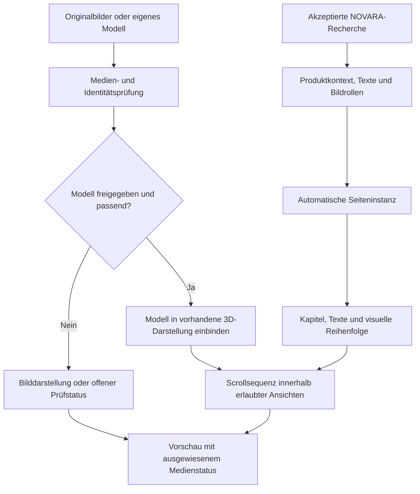

# Product DNA: Wie Recherche automatisch zur Produktpräsentation wird

[← Zur Projektvorstellung](README.md)

## Eine durchgehende Verarbeitung statt einzelner manueller Aufträge

**Der zentrale Ansatz von NOVARA und Product DNA ist die selbstständige Weiterverarbeitung nach dem Start.** Produktinformationen werden nicht nur analysiert und anschließend als Bericht abgelegt. Die Ergebnisse werden zur Grundlage für weitere Aufgaben: Käuferverständnis, Angebotslogik, Verkaufstext, Bildplanung und Seitenaufbau.

Der Benutzer liefert die Ausgangsdaten und startet den Auftrag. Im regulären Ablauf übernimmt die Software danach das Anstoßen der KI-Aufgaben, die Übergabe der Ergebnisse und die Prüfung der nächsten Verarbeitungsschritte. Es ist nicht vorgesehen, dass eine Person nach jeder Phase neue Prompts schreibt, Texte zwischen Werkzeugen kopiert oder die Seite Abschnitt für Abschnitt von Hand aufbaut.

Das ist bereits in Auftragsverarbeitung und Forschungsorchestrierung angelegt und in Teilabläufen umgesetzt. Die vollständige aktuelle Kette einschließlich echter 3D-Produkterzeugung und Shopify-Installation wird noch fertiggestellt und validiert.

## 1. Was nach dem Upload passiert

### Der Auftrag wird automatisch vorbereitet

Eine Produkt-PDF und zwei echte Produktfotos werden einem eigenen Auftrag zugeordnet. Die Anwendung prüft Eingaben und benötigte Einrichtung. Der Hintergrundprozess übernimmt den gespeicherten Auftrag unabhängig vom geöffneten Browserfenster.

### Die Recherche wird für dieses Produkt vorbereitet

NOVARA erfasst Produkt und Quellenrollen und entwickelt einen produktspezifischen Forschungsauftrag. Danach werden Produktverständnis, Käuferfragen, Einwände, Wettbewerber und mögliche Argumente untersucht.

Das System soll dabei unterscheiden, was über das konkrete Produkt belegt ist und was nur den Markt oder die Produktkategorie beschreibt.

### Die Erkenntnisse werden automatisch weitergereicht

Die folgenden Aufgaben erhalten die gespeicherten Ergebnisse ihrer Vorgänger. Käuferanalyse und Angebotslogik bauen auf der Recherche auf. Der Verkaufstext verwendet diese Vorarbeit. Die Bildaufgaben leiten sich wiederum aus Produktidentität, Argumentation und Text ab.

Im gestuften Studio-Pfad führt die Software die definierten Forschungsstufen nacheinander aus. Ausgaben, Konversation und Übergaben werden dem jeweiligen Auftrag zugeordnet. Der Benutzer muss diese Folge nicht manuell moderieren.

### Akzeptierte Forschung kann die Seitenerstellung auslösen

Eine vorhandene automatische Fortsetzung wartet auf einen akzeptierten Forschungsabschluss. Anschließend erstellt sie eine Seiteninstanz innerhalb der festgelegten Kapitelvorlage und ordnet Inhalte und verfügbare Medien zu.

Das Ergebnis ist eine auf dem Forschungs-Handoff aufbauende Präsentation mit sichtbarem Prüfstatus. Fehlende Bilder, Modelle oder Händlerangaben werden dabei nicht durch eine pauschale Fertigmeldung verdeckt.

## 2. Die Rolle von NOVARA Logic und Product DNA

| NOVARA Logic | Product DNA |
|---|---|
| Erarbeitet das Produkt- und Käuferverständnis | Überführt den akzeptierten Kontext in eine visuelle Präsentation |
| Ordnet Quellen und Aussagen ein | Ordnet Texte, Bildrollen, Farben und Medien den vorhandenen Kapiteln zu |
| Entwickelt Angebotslogik und Verkaufstext | Verbindet Kapitel, Detailansichten und Interaktion |
| Erstellt Bildaufgaben und prüft Ausgaben | Bindet verfügbare freigegebene Medien ein |
| Begrenzt unbelegte Produktversprechen | Begrenzt Darstellungen auf die erlaubten Produktansichten |

**Die gemeinsame Grundlage ist der konkrete Produktauftrag.** Text, Bild und Bewegung sollen zusammenpassen und dieselben belegten Eigenschaften vermitteln.

## 3. Was 3D in Product DNA bedeutet

Eine räumliche Produktdarstellung kann Perspektive, Beleuchtung und Kameraführung über ein geladenes Modell verändern. Die Darstellung reagiert dabei auf die Nutzung der Seite.

In der vorhandenen Implementierung gibt es:

- **Modellanzeige mit Three.js:** Laden und Normalisieren geeigneter Modelle, Beleuchtung und Darstellung im Browser.
- **Scrollgesteuerte Sequenzen:** Der Scrollfortschritt steuert vorbereitete Kamera- und Produktpositionen sowie die zugehörigen Textkapitel. Vorwärts und rückwärts lassen sich dieselben Sequenzen ansteuern.
- **Begrenzte Modellbewegung:** Vollständige Drehung, eingeschränkte Bewegung oder keine Drehung hängen vom freigegebenen Ansichtsrahmen ab.
- **Detailansichten:** Die Darstellung kann zwischen dem erzählerischen Seitenverlauf und einer näheren Produktbetrachtung wechseln.
- **Bewegungs- und Medienübergänge:** Im Medienruntime sind GSAP/ScrollTrigger für Produktbewegung, Kamerafahrten, Übergänge und Textanimationen vorhanden. Die Kapitelvorlage verwendet daneben eigene Scrollsteuerung.
- **Ersatzdarstellung:** Bei reduziert gewünschter Bewegung, fehlendem WebGL oder einem nicht nutzbaren Modell können Produktbilder die Darstellung übernehmen.

Der bestehende Renderer definiert die Darstellungsmöglichkeiten. Die Produktinhalte und erlaubten Bewegungen werden daran gebunden. Das System entwickelt derzeit nicht für jeden Auftrag automatisch eine beliebige neue 3D-Engine oder eine völlig neue Seitenarchitektur.

## 4. Welche Entscheidungen automatisch getroffen werden

### Inhalte zuordnen

Aus dem akzeptierten Handoff wird eine Seiteninstanz erstellt. Die vorhandene Vorlage erhält Texte, Kapitelzuordnung und Bildrollen. Die Inhalte sollen auf der Recherche beruhen und keine neuen unbelegten Produkteigenschaften hinzufügen.

### Produktfarben übernehmen

Vorhandene Farblogik kann Produktfarben aus Referenzen beziehungsweise geprüften Produktbereichen ableiten und in die Seitengestaltung übernehmen. Das ist eine Grundlage für die visuelle Abstimmung; es ersetzt keine allgemeine Designfreigabe.

### Ein geeignetes Modell binden

Der lokale Medienadapter kann ein freigegebenes Modell auswählen, wenn dessen Herkunft zur Eingabe des konkreten Forschungslaufs passt. Die bloße Existenz irgendeiner GLB-Datei im Projekt reicht dafür nicht.

### Die Kamerafreiheit begrenzen

Ein Produktfoto von vorn belegt keine Rückseite. Bewegungsgrenzen verhindern deshalb, dass jede Darstellung automatisch eine vollständige 360-Grad-Ansicht verspricht. Im lokalen Rekonstruktionspfad ist für bestimmte weitergehende Bewegungen eine ausdrückliche Freigabe erforderlich.

### Bei fehlenden Voraussetzungen anhalten

Ein fehlendes Modell, eine unzureichende Prüfung oder ein Kontingentproblem soll als eigener Zustand erscheinen. Unterstützte Wartezustände lassen sich unter Nutzung gespeicherter Ergebnisse fortsetzen. Nicht jeder Fehler wird bereits selbstständig behoben.

## 5. So hängen Forschung und 3D zusammen

*Das Diagramm beschreibt vorhandene Funktionen und ihre vorgesehenen Übergaben. Die aktuellen Shopify- und Studio-Zweige sind noch nicht durchgehend zu einem vollständig geprüften 3D-Gesamtlauf verbunden.*

## 6. Modellgenerierung, Darstellung und Video sind verschiedene Aufgaben

Die Shopify-Weiterentwicklung besitzt einen Pfad für hochgeladene Modelle oder eine Tripo-basierte Erzeugung mit anschließender Prüfung.

Das lokale Studio enthält weitere Adapter für TRELLIS, LTX und Blender. Diese benötigen die jeweilige Modelleinrichtung, Ressourcen und Freigaben. Die lokale automatische Medienanfrage ist konfigurationsabhängig und im Studienstart deaktiviert.

Ein geladenes 3D-Modell zeigt räumliche Geometrie. Ein daraus gerendertes Video ist ein Film. Eine Scroll-Animation steuert die Darstellung auf der Seite. Das sind verwandte, aber unterschiedliche Funktionen — das Vorhandensein einer davon belegt nicht automatisch die anderen.

## 7. Was „ohne manuelle Zwischenarbeit“ bedeutet

Für den regulären Ablauf bedeutet es:

- Kein neuer Benutzerprompt zum Start jeder Forschungsphase.
- Kein manuelles Kopieren der Forschung in Käuferanalyse und Textaufgaben.
- Keine manuelle Übergabe jedes akzeptierten Forschungsergebnisses an die vorhandene Seitenerstellung.
- Keine manuelle Programmierung jeder Kameraposition für jeden neuen Produktauftrag.
- Keine laufende Browserbedienung, damit der Hintergrundauftrag weiterarbeitet.

Die vorhandenen Vorlagen, Regeln und Abläufe werden vorher entwickelt. Im Produktlauf arbeitet die Software innerhalb dieses Rahmens.

**Automatische Verarbeitung und abschließende Freigabe sind unterschiedliche Dinge.** Eine Prüfung durch den Händler am Ende nimmt dem vorherigen automatischen Ablauf nicht seine Funktion. Fehlende Daten, gescheiterte Qualitätsprüfungen und noch nicht verbundene Medienpfade können heute allerdings zusätzliche Eingriffe erfordern.

## 8. Das vorhandene Ergebnis und die öffentliche 3D-Demo

Die Projektvorstellung zeigt eine tatsächlich in Shopify gespeicherte Foundation-Produktseite aus der bestehenden NOVARA-Logic-App. In der [Beispielstrecke](NOVARA_BEISPIEL.md) sind der Einstieg, ein Nutzenkapitel und die Anwendung zu sehen. Die zugeordnete Käuferanalyse und das Ergebnisverzeichnis wurden geprüft.

Dieses Ergebnis gehört zum NOVARA-Logic-Seitenpfad. Es wird nicht als bereits fertiggestellte Product-DNA-3D-Seite bezeichnet.

**Eine echte freigegebene Produkt-3D-Demo liegt für diesen öffentlichen Auftritt noch nicht vor.** Die vorhandenen schwarzen/geometrischen Platzhalter und Testwürfel werden nicht als fertige Produktmodelle gezeigt. Eine spätere echte Demo soll ein geprüftes Produkt, seine Scrollbewegung und seine Detailansichten sichtbar machen.

Die animierte Ablaufgrafik auf der Startseite erklärt die Verarbeitung. Sie ist entsprechend gekennzeichnet und keine Live-Aufzeichnung.

## 9. Warum diese Verbindung interessant ist

Der Ansatz verbindet Produktverständnis mit Umsetzung: Aus Käuferfragen und belegten Produkteigenschaften entstehen Inhalte, die automatisch in eine vorhandene visuelle Erfahrung übergehen können.

Für die Weiterentwicklung sind die Aufgaben greifbar: Medienpfade vollständig verbinden, echte Produktmodelle prüfen, die mobile Darstellung verfeinern und den aktuellen Gesamtweg bis zur Shopify-Kaufabwicklung nachweisen.

**Product DNA ist die bestehende visuelle Weiterentwicklung dieses automatisierten Systems. Die vollständige echte 3D-Auslieferung ist der nächste nachzuweisende Entwicklungsschritt.**

[Interesse an einer Zusammenarbeit?](https://github.com/besey40/NOVARA-Design-Studio/issues/new)

---

Öffentliche Beschreibung des Entwicklungsstands vom November 2026. Dieses Dokument enthält keinen Anwendungscode und keine internen Prompt- oder Konfigurationsdateien.
