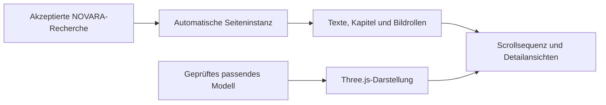

# NOVARA Logic & Product DNA

## Einmal starten. Produkt recherchieren. Inhalte automatisch weiterverarbeiten.

**NOVARA verbindet Produktrecherche, Käuferverständnis, Verkaufstexte, Bildplanung und Shopify-Seitenerstellung zu einem zusammenhängenden Workflow.**

Ausgangspunkt sind eine Produkt-PDF und zwei echte Produktbilder. Nach dem Start steuert die Software die definierten Aufgaben, speichert Zwischenergebnisse und gibt sie an die nächste Phase weiter. Im regulären Ablauf muss niemand jede Recherchephase einzeln anstoßen, neue Zwischenprompts schreiben oder die Ergebnisse von Hand zur Seite zusammensetzen.

**NOVARA Logic erarbeitet die Inhalte. Product DNA entwickelt ihre visuelle Präsentation mit Scroll-Interaktionen und 3D weiter.**

[Das echte NOVARA-Ergebnis ansehen](#ein-echtes-ergebnis-aus-novara-logic) · [Product DNA und 3D verstehen](PRODUCT_DNA.md) · [Kontakt](https://github.com/besey40/NOVARA-Design-Studio/issues/new)

## So arbeitet die Automatisierung

*Erklärende Ablaufgrafik, keine Live-Aufzeichnung. [Statische Ansicht ohne Animation](assets/novara-workflow-static.png).*

| Phase | Was die Software übernimmt |
|---|---|
| Produkt verstehen | Unterlagen und Originalbilder erfassen, sichtbare Eigenschaften und offene Fragen einordnen |
| Recherchieren | Einen produktspezifischen Forschungsauftrag entwickeln und Produkt, Käuferfragen, Einwände und Wettbewerb untersuchen |
| Verkaufslogik entwickeln | Die Erkenntnisse in Käuferanalyse, Nutzenargumente und Angebotslogik weiterverarbeiten |
| Inhalte erstellen | Darauf aufbauende Verkaufstexte und Bildaufgaben erzeugen; im vorhandenen Shopify-Pfad Bilder erstellen und prüfen |
| Seite zusammenführen | Texte und Medien in vorhandene Vorlagen übernehmen und ein Shopify-Ergebnis bereitstellen |

**Die Übergaben sind Teil der Software.** Die Ergebnisse einer Aufgabe werden zur Arbeitsgrundlage der nächsten. Der Kunde muss den laufenden Auftrag nicht durch wiederholte manuelle Anweisungen moderieren.

Qualitätsprobleme, fehlende Informationen oder Kontingente können den Ablauf anhalten. Unterstützte Wartezustände lassen sich mit vorhandenen Ergebnissen fortsetzen. Abschließende Freigaben und nicht automatisch lösbare Fehler bleiben davon getrennt.

## Ein echtes Ergebnis aus NOVARA Logic

### 2-in-1 Foundation-Stick mit Pinsel

**Die folgende Aufnahme zeigt eine tatsächlich in Shopify gespeicherte NOVARA-Produktseite aus einem abgeschlossenen Auftrag.** Sie wurde am 4. November 2026 in der vorhandenen Shopify-Vorschau aufgenommen.

Zum zugehörigen Auftrag wurden die gespeicherten Eingaben, der Abschlussstatus, die Käuferanalyse und das Ergebnisverzeichnis geprüft. Der Ergebnislink der App führt zu derselben Produktvorlage. Das Verzeichnis enthält unter anderem Recherche, Rohquellen, Käuferanalyse, Angebotsbriefing, Verkaufstext, sechs Bildrollen und Shopify-Exportdateien.

*Unveränderter Inhaltsausschnitt der Dev-Store-Seite. Preis und Sterne sind dort konfigurierte Demo-Inhalte; sie werden hier nicht als Nachweis echter Verkäufe oder Kundenbewertungen verwendet.*

### Wie die Käuferlogik auf der Seite sichtbar wird

Die Käuferanalyse dieses Laufs behandelt unter anderem den Wunsch nach einem natürlicher wirkenden Ergebnis, kontrolliertem Auftrag und weniger Aufwand durch einen separat benötigten Pinsel. Die fertige Seite greift diese Themen in Text und Bild auf.

**Das Beispiel zeigt eine konkrete Verarbeitungskette:** Käuferproblem → Nutzenargument → Bildaufgabe → zusammengeführter Seitenabschnitt.

➡️ **[Die vollständige Beispielstrecke mit Anwendung und Einordnung ansehen](NOVARA_BEISPIEL.md)**

Die Aufnahmen belegen ein vorhandenes Shopify-Ergebnis. Sie sind kein Nachweis gemessener Conversion-Steigerung oder eines vollständig eingriffsfreien Ablaufs aller damaligen Zwischenschritte.

## Die Logic hinter den Ergebnissen

NOVARA soll aus recherchierten Informationen nachvollziehbare Inhaltsentscheidungen entwickeln:

| Grundlage | Entscheidung für die Präsentation |
|---|---|
| Produktunterlagen und Originalfotos | Welche Eigenschaften dürfen über dieses konkrete Produkt beschrieben werden? |
| Käuferfragen und Einwände | Was muss die Seite erklären, damit das Angebot verständlich wird? |
| Nutzen- und Angebotslogik | Welche Argumente gehören in Einstieg, Nutzenkapitel und Anwendung? |
| Visuelle Produktidentität | Wie sollen Form, Farbe und wichtige Details in den Bildern erhalten bleiben? |
| Fehlende Nachweise | Welche Aussagen müssen begrenzt oder ausgelassen werden? |

Wettbewerberinformationen werden von eigenen Produktnachweisen unterschieden. Ein fremdes Produkt mit einer bestimmten Eigenschaft belegt diese Eigenschaft nicht für das eigene Angebot.

Dateien, Bilder und Ergebnisse bleiben dem jeweiligen Produktauftrag zugeordnet. Prüfungen und begrenzte Korrekturversuche sollen verhindern, dass ungeeignete oder vertauschte Ausgaben ungeprüft weiterlaufen. KI-Ausgaben benötigen dennoch Qualitätskontrolle.

## Product DNA: Die visuelle Weiterentwicklung mit 3D

**Product DNA verbindet akzeptierte NOVARA-Ergebnisse mit einer vorhandenen animierten Kapitelvorlage.** Eine automatische Fortsetzung kann nach dem Forschungsabschluss eine Seiteninstanz erstellen und Texte, Bildrollen, Farben und verfügbare Medien zuordnen.

Die vorhandene 3D-Darstellung umfasst:

- **Three.js-Modellanzeige:** geeignete Modelle laden, normalisieren und beleuchten;
- **scrollgesteuerte Sequenzen:** vorbereitete Kamera- und Produktbewegungen mit Textkapiteln verbinden;
- **Detailansichten:** zwischen erzählerischem Seitenverlauf und näherer Produktbetrachtung wechseln;
- **begrenzte Perspektiven:** Bewegung nur innerhalb des freigegebenen Ansichtsrahmens;
- **GSAP-/ScrollTrigger-Interaktionen:** Medienübergänge, Kamerafahrten und Textanimationen im Medienruntime;
- **Ersatzdarstellungen:** Produktbilder bei fehlendem WebGL oder reduziert gewünschter Bewegung.

Die Seiten- und Bewegungslogik ist vorab entwickelt. Im Produktlauf verwendet die Software diesen Rahmen; nicht jede Kameraposition muss für jedes Produkt erneut von Hand programmiert werden.

**Die oben gezeigte Foundation-Seite ist ein Ergebnis der bestehenden NOVARA-Logic-App.** Die aktuelle vollständige Product-DNA-Kette aus neuer Recherche, echter KI-3D-Produkterzeugung und Shopify-Installation wird noch fertiggestellt. Eine freigegebene echte Produkt-3D-Demo liegt für diesen Auftritt noch nicht vor; Platzhalter werden dafür nicht als fertige Modelle gezeigt.

➡️ **[Product DNA, Automatisierung und 3D ausführlich erklärt](PRODUCT_DNA.md)**

## Was heute vorhanden ist — und was als Nächstes folgt

| Vorhanden und dokumentiert | Noch fertigzustellen beziehungsweise zu validieren |
|---|---|
| Shopify-App mit Upload, Auftragsverwaltung und Ergebnissen | Aktuelle Entwicklungszweige zu einem verbindlichen Auslieferungsstand zusammenführen |
| Automatische Aufgabensteuerung und reale Forschungsläufe | Fehlerbehandlung und Wiederaufnahme weiter absichern |
| In Shopify gespeicherte NOVARA-Produktseite | Aktuellen vollständigen Produktlauf einschließlich echter 3D-Medien nachweisen |
| Bestehende Product-DNA-Kapitelvorlage, 3D-Runtime und Vorschau-Export | Durchgehende Medienintegration, mobile Performance und aktuelle Shopify-Auslieferung abschließen |

**Entwicklungsstand: November 2026.** Das Projekt wird aktiv entwickelt und ist noch nicht allgemein verfügbar.

## Gemeinsam weiterentwickeln

Die bestehende Grundlage verbindet Recherche und Automatisierung mit einer konkreten Anwendung. Für die Weiterentwicklung und spätere kommerzielle Veröffentlichung als Shopify-App suchen wir den Austausch mit technischen Mitgestaltern — besonders in **Frontend, Shopify, Three.js, GSAP, 3D und Animation**.

Die Aufgaben sind greifbar: vorhandene Inhalte und Medien zuverlässig zusammenführen, eine hochwertige mobile Produktpräsentation schaffen und den gesamten Ablauf bis zur Shopify-Kaufabwicklung belastbar machen.

**[Interesse an einer Zusammenarbeit oder fachlichem Austausch? Kontakt über GitHub aufnehmen.](https://github.com/besey40/NOVARA-Design-Studio/issues/new)**

---

### English overview

NOVARA automates the handoffs between product research, buyer understanding, copy, image planning and Shopify page assembly. This presentation includes screenshots of an actual Shopify result from the existing NOVARA Logic app. Product DNA adds an evolving Three.js and animation layer; its latest complete real-product 3D workflow remains under development. We welcome potential development collaborators.

---

**Dieses Repository enthält ausschließlich die öffentliche Projektvorstellung und ausgewählte Ergebnisaufnahmen. Anwendungscode, Zugangsdaten und interne Forschungsdateien bleiben privat.**
