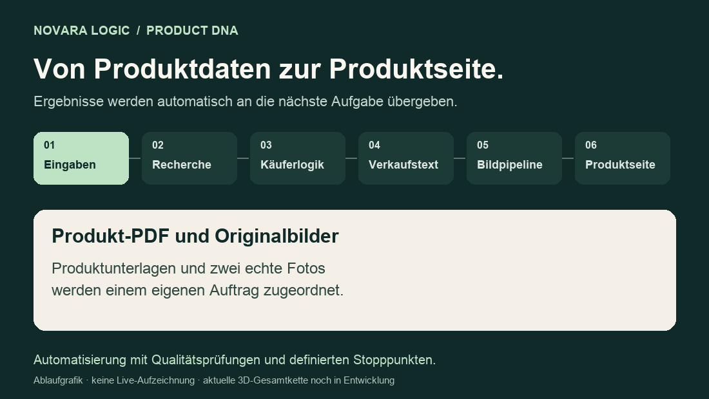
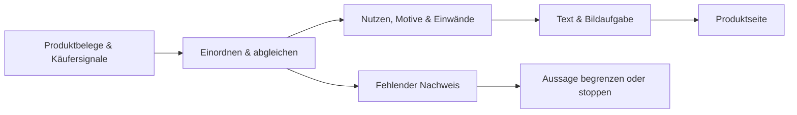
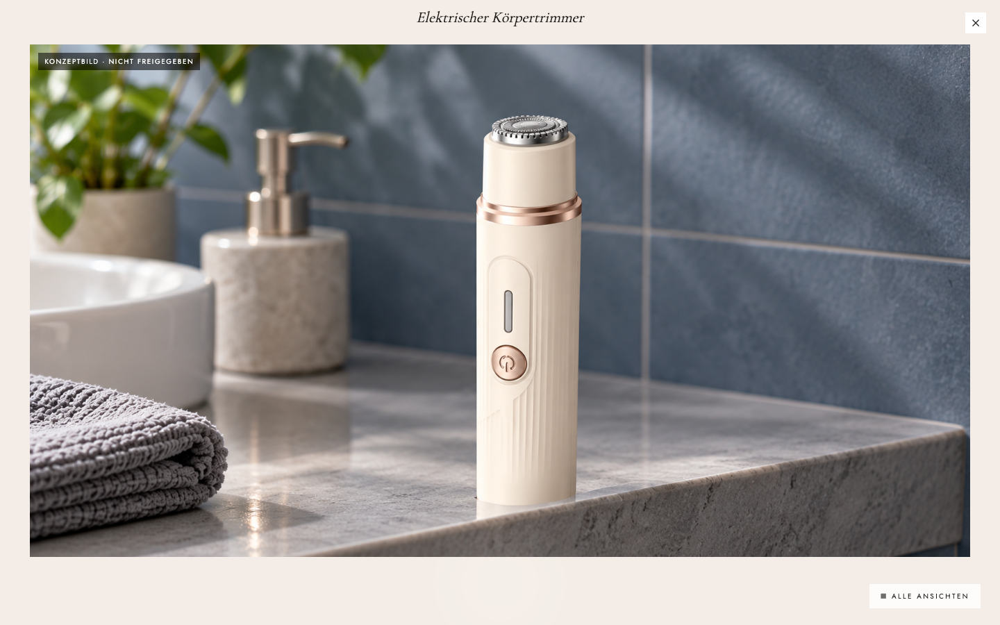
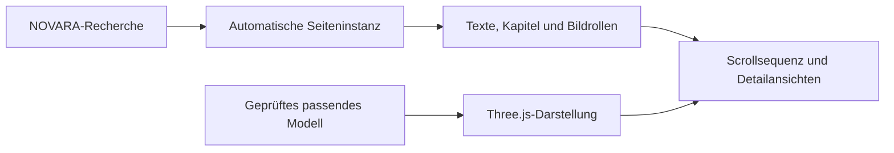

# NOVARA Logic & Product DNA

## Einmal starten. Recherche, Inhalte und Produktseite automatisch weiterverarbeiten.

**Produkt verstehen. Käufer verstehen. Verkaufsargumente entwickeln. Inhalte und Bilder erstellen. Die Produktseite zusammensetzen.**

NOVARA verbindet diese Aufgaben zu einem zusammenhängenden, KI-gesteuerten Prozess. Ausgangspunkt sind eine Produkt-PDF und zwei echte Produktbilder. Daraus entwickelt das System eine strukturierte Grundlage für die Produktpräsentation: recherchierte Erkenntnisse, Käuferprofile, Angebotslogik, Verkaufstexte und Bildkonzepte.

**Der Kern ist die selbstständige Verarbeitung nach dem Upload.** Die Software startet die definierten Aufgaben, übergibt ihre Ergebnisse an die nächste Phase und führt die vorgesehenen Prüfungen aus. Im regulären Ablauf muss keine Person jede Forschungsphase anstoßen, neue Zwischenprompts schreiben oder Inhalte von Hand in den Seitenaufbau übertragen.

Die Ergebnisse bleiben im selben Produktkontext: Recherche wird zur Grundlage der Käuferanalyse, daraus entstehen Angebotslogik, Verkaufstext und Bildaufgaben. Akzeptierte Forschung kann anschließend automatisch eine Seiteninstanz in Product DNA auslösen.

**NOVARA Logic erarbeitet das Produktverständnis. Product DNA überführt den akzeptierten Kontext in eine visuelle Produktpräsentation** — mit gestalteten Kapiteln, Scroll-Animationen, Detailansichten und einer bestehenden Anbindung für geprüfte 3D-Medien.

➡️ **[Product DNA und 3D ausführlich erklärt: Was automatisch passiert und wie Recherche die Darstellung steuert](PRODUCT_DNA.md)**

**Für Shopify-Händler, E-Commerce-Teams und Agenturen, die Produktverständnis und Seitenerstellung in einem durchgängigen Ablauf verbinden möchten.**

---

## Den Ablauf sehen

*Die Grafik erklärt den automatisierten Ablauf. Sie ist keine Live-Aufzeichnung. [Statische Ansicht ohne Animation](assets/novara-workflow-static.png).*

## Was aus der Recherche tatsächlich entsteht

**Beispiel Körpertrimmer:** Ein dokumentierter Forschungsdurchlauf enthält 22 Evidenzeinträge aus 14 unterschiedlichen URLs. Die Quellen werden nach ihrer Rolle ausgewertet. Diese Zahlen beschreiben den Umfang dieses Beispiels, keine Qualitätsnote.

Entscheidend ist die Verbindung zwischen Fund, Schlussfolgerung und Darstellung:

| Recherchefrage | Erkenntnis und Einordnung | Konsequenz für die Produktseite |
|---|---|---|
| Wollen Käufer überall dasselbe Ergebnis? | Kürzen und möglichst glatte Rasur sind unterschiedliche Ergebnisziele. | Die Seite beginnt mit der Entscheidungsfrage: „Kürzen oder möglichst glatt rasieren: Was ist dir wichtig?“ |
| Muss eine bestehende Pflegeroutine ersetzt werden? | Die recherchierten Routinen und Gegenbefunde werden berücksichtigt. | Der Text erklärt Auswahlmöglichkeiten, statt einen Wechsel pauschal als notwendig darzustellen. |
| Welche Eigenschaften sind am konkreten Produkt erkennbar? | Schlanke Form, cremeweißes Gehäuse und roségoldfarbene Ringe sind aus den Referenzen beschrieben. | Diese Merkmale werden in Text und visueller Produktdarstellung aufgegriffen. |
| Welche Aussagen fehlen in den Produktunterlagen? | Unter anderem Wasserfestigkeit und Laufzeit sind nicht ausreichend belegt. | Solche Eigenschaften werden nicht als zugesicherte Kaufvorteile ergänzt. |

**Die Logic dahinter:** Aus einer Quelle wird eine eingeordnete Erkenntnis. Daraus entsteht ein zulässiges Argument — und erst anschließend die Entscheidung, wie es in Text oder Bild vermittelt wird.

*Das Beispiel ist anhand vorhandener interner Laufartefakte zusammengefasst. Es zeigt die Verarbeitung von Erkenntnissen; es belegt keine gemessene Conversion-Steigerung.*

## Einblick in die visuelle Darstellung

*Originalansicht aus der vorhandenen Desktop-Vorschau. Das sichtbare Produktbild ist als Konzeptbild gekennzeichnet. Die Aufnahme zeigt die Gestaltungsrichtung, kein fertig freigegebenes 3D-Modell und keinen vollständig veröffentlichten Shop.*

---

## Was NOVARA automatisch übernimmt

### 1. Das Produkt und seine Käufer analysieren

Nach dem Start verarbeitet NOVARA die Produktunterlagen und Originalbilder und entwickelt einen produktspezifischen Rechercheauftrag. Untersucht werden unter anderem:

- Eigenschaften und erkennbare Besonderheiten des Produkts;
- mögliche Zielgruppen, Anwendungssituationen und Kaufmotive;
- Käuferfragen, Einwände und bisherige Lösungsversuche;
- Wettbewerber, Marktangebote und relevante Quellen;
- die Grenze zwischen belegten Produkteigenschaften und offenen Informationen.

Die Recherche dient anschließend als Grundlage für die weiteren Inhalte.

### 2. Aus Erkenntnissen eine Verkaufslogik entwickeln

Das System verarbeitet die Forschung zu Käuferprofilen, Nutzenargumenten, Angebotslogik und Verkaufstexten weiter.

Dabei geht es um konkrete Entscheidungen: Welches Problem sollte zuerst erklärt werden? Welcher Nutzen ist für den Käufer relevant? Welcher Einwand muss beantwortet werden? Welche Aussage ist durch die vorhandenen Informationen gedeckt?

Diese Ergebnisse werden gespeichert und an die nachfolgenden Aufgaben übergeben. Neue Anweisungen nach jeder Forschungsphase sind im regulären Ablauf nicht erforderlich.

### 3. Produktbilder planen, erzeugen und prüfen

NOVARA leitet Bildaufgaben aus den Inhalten ab. Die vorhandene Shopify-Bildpipeline umfasst sechs Rollen: Hero, Problem, Nutzen, Vergleich, Anwendung und Vertrauen.

Originalbilder dienen als Referenz für die Produktidentität. Eine visuelle KI-Prüfung bewertet die Ergebnisse; erkannte Fehler können begrenzte Korrekturversuche auslösen. So sollen Bilder und Texte dieselbe Produktgeschichte vermitteln.

### 4. Inhalte zur Produktseite zusammensetzen

Texte, Bilder und Seitenelemente werden über vorhandene Seitenvorlagen zusammengeführt. Die Shopify-App verwaltet Uploads, Aufträge, Bearbeitungsstatus, Detailansichten und Ergebnisse.

Der Hintergrundprozess arbeitet unabhängig davon, ob die Auftragsseite im Browser geöffnet bleibt. Zwischenergebnisse bleiben gespeichert. Nach Freigabe kann der vorhandene Installationspfad eine Produktvorlage und ihre Dateien an Shopify übertragen.

---

## Autonomie mit nachvollziehbaren Entscheidungen

Die Automatisierung umfasst mehr als die Generierung einzelner Texte:

| Funktion | Beitrag zum Ablauf |
|---|---|
| Automatischer Auftragsstart | Eingaben werden geprüft, gespeichert und zur Verarbeitung eingereiht |
| Gesteuerte Aufgabenfolge | Forschungsergebnisse werden an Käuferanalyse, Text- und Bildplanung weitergegeben |
| Dauerhafte Zwischenstände | Ergebnisse und Bearbeitungszustände bleiben dem Auftrag zugeordnet |
| Qualitätsprüfungen | Struktur, bestimmte Inhaltsgrenzen und Medien werden vor der Weiterverarbeitung kontrolliert |
| Begrenzte Korrekturen | Bestimmte Fehler können ohne einen neuen Benutzerprompt bearbeitet werden |
| Definierte Stopppunkte | Fehlende Nachweise, Kontingente oder Qualitätsprobleme führen zu einem erkennbaren Status |
| Wiederaufnahme | Unterstützte Wartezustände können unter Nutzung vorhandener Ergebnisse fortgesetzt werden |

**Im regulären Ablauf steuert die Software die Arbeit selbstständig weiter.** Das betrifft das Starten der KI-Aufgaben, ihre Reihenfolge und die Übergabe gespeicherter Ergebnisse. Es ist nicht vorgesehen, dass ein Mensch jede Stufe moderiert oder die Seite während des Auftrags manuell zusammensetzt.

Abschließende Freigaben bleiben davon getrennt. Fehlende Informationen, eine gescheiterte Prüfung oder noch nicht vollständig verbundene Medienpfade können aktuell zusätzliche Eingriffe erfordern. Eine fehlerfrei durchlaufende aktuelle 3D-Gesamtkette ohne jeden Eingriff ist noch nicht nachgewiesen.

## Product DNA: Von der Recherche zur räumlichen Produktpräsentation

Product DNA ist die visuelle Weiterentwicklung des NOVARA-Workflows. Eine vorhandene automatische Fortsetzung wartet auf den akzeptierten Forschungsabschluss, erstellt eine Seiteninstanz und ordnet die Inhalte der bestehenden Kapitelvorlage zu.

**Der Zusammenhang ist konkret:** Produktverständnis und Käuferargumente liefern den Inhalt. Product DNA verbindet ihn mit Textkapiteln, Bildrollen, Farben, Details und den verfügbaren freigegebenen Medien.

### So arbeitet die vorhandene 3D-Darstellung

- **Three.js lädt und beleuchtet das geeignete Modell.** Die Modellgröße wird für die Präsentation normalisiert.
- **Scrollen steuert die Sequenz.** Kamera, Produktposition und Textkapitel folgen vorbereiteten Übergängen; auch beim Zurückscrollen.
- **Die Produktansichten begrenzen die Bewegung.** Je nach Freigabe ist eine volle Drehung, eine eingeschränkte Ansicht oder keine Drehung erlaubt.
- **Detailansichten führen näher an das Produkt.** Der Benutzer kann zwischen Seitenverlauf und Produktbetrachtung wechseln.
- **GSAP/ScrollTrigger ergänzen Medienbewegungen.** Im Medienruntime sind Übergänge, Kamerafahrten und Textanimationen vorhanden.
- **Bilddarstellungen bleiben verfügbar.** Bei fehlendem WebGL oder reduzierter Bewegung bestehen Ersatzwege.

Die Seiten- und Bewegungslogik wird vorab entwickelt. Im Produktlauf verwendet die Software diesen Rahmen; für jedes Produkt muss nicht jede Kameraposition neu von Hand programmiert werden.

**Aktueller Stand:** Inhaltsübergabe, bestehende 3D-Darstellung und Medienadapter sind vorhanden. Die komplette aktuelle Verbindung aus neuer Recherche, echter Modellerzeugung und Shopify-Installation wird noch fertiggestellt. Eine echte freigegebene Produkt-3D-Demo wird ergänzt, sobald sie vorliegt; ausgeschlossene Platzhalter werden dafür nicht verwendet.

**[Die vollständige Erklärung lesen →](PRODUCT_DNA.md)**

## Produktidentität und Quellen als gemeinsame Grundlage

NOVARA unterscheidet eigene Produktnachweise, Wettbewerberinformationen und Käufererfahrungen. Eine Eigenschaft eines Wettbewerbers darf nicht automatisch als Eigenschaft des eigenen Produkts erscheinen.

Originalbilder, Forschung und Medien bleiben an das jeweilige Produkt und seinen Auftrag gebunden. Prüfungen sollen verhindern, dass fremde oder nachträglich veränderte Ergebnisse ungeprüft übernommen werden. Fehlende Produktansichten und Informationen werden als Lücken behandelt.

Diese Regeln machen den Ablauf nachvollziehbarer. KI-Ausgaben benötigen dennoch Qualitätskontrolle.

## Entwicklungsstand

**Aktive Entwicklung · Stand: November 2026**

Eine Shopify-App, automatisierte Forschungsabläufe, Bildverarbeitung und Seitenexport sind implementiert. Reale Forschungsläufe, eine frühere Shopify-Installation und der Studio-Vorschau-Export sind dokumentiert.

Die aktuelle vollständige Verbindung von neuem Upload, echter KI-3D-Produkterzeugung und anschließender Shopify-Installation wird noch fertiggestellt und validiert. Die Anwendung ist noch nicht allgemein verfügbar.

## Gemeinsam weiterentwickeln

Für die Weiterentwicklung und eine spätere kommerzielle Veröffentlichung als Shopify-App suchen wir den Austausch mit technischen Mitgestaltern — besonders in den Bereichen **Frontend, Shopify, Three.js, GSAP, 3D und Animation**.

Die Aufgaben sind konkret: vorhandene Automatisierung und Produktdarstellung zusammenführen, reale Produktmedien zuverlässig integrieren und eine hochwertige mobile Nutzung bis zur Shopify-Kaufabwicklung ermöglichen.

**Interesse an einer Zusammenarbeit oder einem fachlichen Austausch?**  
[Kontakt über GitHub aufnehmen](https://github.com/besey40/NOVARA-Design-Studio/issues/new)

---

### English overview

NOVARA connects product research, buyer understanding, offer development, copy, image planning and Shopify page assembly in an automated workflow. Each phase passes its results to the next, reducing repeated prompting and manual handoffs. Product DNA adds an evolving presentation layer with Three.js, animation and media integration.

Existing components and documented runs provide a working foundation; the latest complete real-product 3D-to-Shopify workflow remains under development. We welcome conversations with potential collaborators experienced in frontend engineering, Shopify, Three.js, GSAP and product visualization.

---

**Dieses Repository enthält ausschließlich die öffentliche Projektvorstellung. Anwendungscode, interne Forschungsunterlagen und Zugangsdaten bleiben privat.**
